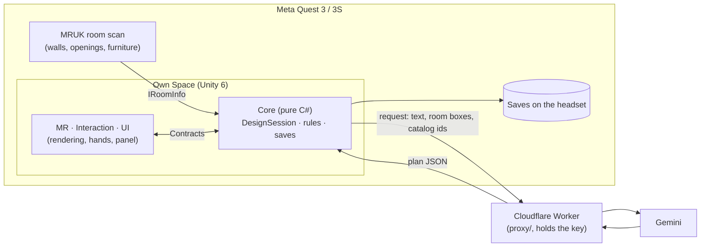

# Own Space

**The room you can't change, made your own.** Own Space redesigns your dorm, rental or hotel room around you on Meta Quest, with your hands only, while your real desk stays real and within reach.

**688 EditMode tests · 72 Hz target · hands only, no controllers · AI places catalog pieces only, never camera images**

Scan your room and mark the part you use: your desk stays real and within reach. Everything else becomes a virtual room you design with your hands: walls, floor, furniture and light. Your real desk or bed keeps its place and height under a new look. Then keep the room running in the background while you work on your laptop, watch YouTube, or use Meta's virtual displays. Save the room, and open it again anywhere, at a hotel desk or in a dorm.

## Features

- **Room scan and my zone.** The app reads the Quest room scan and proposes the area you use, around your desk or bed. Adjust its corners with a pinch. Inside it, everything stays real.
- **My room.** Pick a new design for your real desk, bed or closet. It keeps the real piece's footprint and usable height, so it stays just as usable.
- **Style.** One finish for the floor and one for the walls covers the whole room, my zone included, or keep any surface real.
- **Add.** Pick a piece and pinch the floor. If the spot doesn't work, the app suggests the nearest one that does: against a wall, or on open floor facing you.
- **AI room design.** Type a request or tap a style. The AI furnishes the virtual room with catalog pieces only: one piece of each kind, and never a second copy of a kind you placed yourself. A new style replaces the last one, and one Undo brings it back.
- **Tidy up.** Draw a box over laundry or clutter in your zone, and cover it with the floor or a prop.
- **Moods.** Morning, afternoon, evening or night. The virtual lights and the passthrough tint change together, and virtual surfaces are tone-matched to the real room so the two read as one space.
- **A background room.** Open the Meta menu, YouTube or Meta's virtual displays: Own Space hides its tools and keeps your room around you.
- **Saved spaces.** Save a room, and open it anywhere: it is rebuilt around the desk or bed you're at, and your zone and changes come back next visit. A built-in sample room needs no scan.
- **Hands only.** Pinch, grab and poke. No controllers, and every action answers with a highlight or animation.

## How it works

The Unity app reads the room from MRUK and keeps every rule in a pure C# core: zones, the design, placement and fit rules, saves and the AI plan check. The scene layers (MR, Interaction, UI) only draw and take input, through the core's `DesignSession`. The AI request goes through a Cloudflare Worker that holds the API key, and the core checks every answer before it touches the design.

- **[Core](app/Assets/_Project/Core/)** (C#, no engine APIs): the design session with undo, zones, placement and fit rules, the AI request and plan checker, saves, saved spaces and the guided first run. Covered by EditMode tests in [Tests](app/Assets/_Project/Tests/).
- **[Contracts](app/Assets/_Project/Contracts/)**: the shared types (`IRoomInfo`, `DesignState`, catalog items, onboarding state) and their Fakes for testing without a headset.
- **[MR](app/Assets/_Project/MR/)**: reads MRUK into `IRoomInfo`, the zone setup, the virtual room shell, redesigned and placed furniture, moods, Focus mode, saved-space visits and per-room saves.
- **[Interaction](app/Assets/_Project/Interaction/)**: the hand rig, steady aiming and input debugging.
- **[UI](app/Assets/_Project/UI/)**: the glass tool panel, its layout, text and themes.
- **[Content](app/Assets/_Project/Content/)**: the furniture catalog, finishes, mood presets and AI style presets, as data.
- **[proxy/](proxy/)** (TypeScript, Cloudflare Workers): checks the request shape, calls Gemini with a JSON schema that only allows catalog ids, and returns the plan.

More detail is in [ARCHITECTURE.md](ARCHITECTURE.md).

## Using it

You need a Meta Quest 3 or 3S with hand tracking on.

1. **Install.** Open the Invite link on the Devpost page while signed in to your Meta account, accept it, and install Own Space from the headset library. Developers can sideload an APK instead: `adb install -r ownspace-v<version>-<commit>.apk`.
2. **Scan the room.** Run Space Setup in the Quest settings if the room has no scan, or pick **Use sample room** in the app.
3. **Allow spatial data** when the app asks: it needs the room scan. The app doesn't use the microphone, and no camera images leave the headset.
4. **Confirm your zone** around your desk, then use the panel beside your right hand: pinch with a hand ray, or poke it when it's close. The AI design needs a network; everything else works offline.

## Known limits

- **Seated use.** Real furniture outside your zone is hidden behind the virtual room. Stay seated, and keep the Quest boundary on.
- **AI needs a network**, and places catalog pieces only. It does not generate 3D models.
- **Meta's system windows** (the Meta menu, YouTube, virtual displays) draw over the app's panel. That is Meta's layer, not ours.
- **Shared rooms.** A person who walks in outside your zone is not shown. Tell people around you, and take the headset off to talk.
- **Privacy.** No microphone, no camera images, no account. Only an AI request leaves the headset: your typed text, room outlines and catalog ids, sent to Google's Gemini through our Worker. Don't type private information into it.
- **A saved space is a snapshot** of the room when you saved it. Save again to include later changes.

## Building from source

- **App:** Unity 6000.3.20f1 with Android Build Support. Install Git LFS, clone, run `git lfs pull`, and open `app/`. Meta packages come from Meta's registry in `app/Packages/manifest.json`.
- **Build:** `.github/scripts/build-android.sh` builds the APK in batch mode, and `.github/scripts/install-quest.sh` builds, installs and launches it over USB. Release builds are logged in [docs/release/CHANGELOG.md](docs/release/CHANGELOG.md).
- **Tests:** `.github/scripts/unity-check.sh` compiles in batch mode and runs the EditMode tests. CI runs them on every PR.
- **AI proxy:** in `proxy/`, run `npm install` and `npm test`. Store the Gemini key with `npx wrangler secret put GEMINI_API_KEY`, then run `npx wrangler deploy`. The key lives only as a Worker secret, never in the repo or the app. See [proxy/README.md](proxy/README.md).

Own Space was built by four AI coding agents working in parallel, each owning its own folders (core, XR, build, content), with one human making the decisions and testing on the headset. The rules they followed are in [AGENTS.md](AGENTS.md). The demo plan is in [docs/demo/](docs/demo/).
